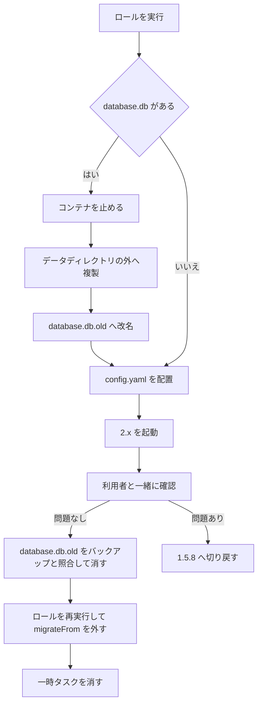

# filebrowser v2 アップグレード設計

## 目的

fox の nas.rewse.jp で動く FileBrowser Quantum を 1.5.8-stable から 2.x の stable に上げる。使い方は変えない。1.x の最後のリリースは 2026-10-04 の 1.5.8 で、その後のセキュリティ修正（2.0.1 の High 1 件、2.0.2 の High 2 件など）は 2.x にだけ出ている。このプロジェクトは 2026 年前半だけで 10 件の advisory を出しており、1.x に留まると修正を受けられなくなる。

## 現状

ロール `filebrowser` は config、container、apache、fail2ban の 4 コンポーネントからなる。container は `aged_release` で `^\d+\.\d+\.\d+-stable$` に合う 4 日経過の最新版を選ぶので、今は 2.0.1-stable が選ばれる。v1 の設定のままでは 2.x は起動しないため、2026-10-25 のコンテナ更新では filebrowser だけ外して 1.5.8 のままにした。

データは `/srv/filebrowser`（NVMe 上にあり、restic のホストバックアップの対象）に置かれ、`config.yaml`、BoltDB の `database.db`（128 KB）、サムネイルの `cache/` がある。コンテナからは `/home/filebrowser/data` に見える。公開しているのは Home の 1 ソースで、設定とバインドマウントの両方で読み取り専用にしている。config で定義した admin がパスワードとパスキー（スマホの Face ID）でログインし、共有リンクも使っている。

`config.yaml.j2` は v1 の形式で、v2 で変わる次の項目を使っている。

- `server.port`、`server.baseURL`、`server.externalUrl`、`server.disableWebDAV`。v2 ではトップレベルの `http` に移った。
- `server.database`。v2 では `path` と `migrateFrom` を持つオブジェクトになった。
- `http.trustedHeaders`。v2 で削除され、真偽値の `http.trustProxyHeaders` に置き換わった。
- `userDefaults.account.permissions` の `create`、`delete`、`modify`。v2 の `account.permissions` は `admin`、`api`、`share`、`realtime` だけを持ち、ファイル操作の権限はソースごとの設定に移った。

fail2ban は Apache の `other_vhosts_access.log` から `POST /api/auth/login` の 401 と 403 を数える。2.0.1 でもログインは `POST /api/auth/login`、ヘルスチェックは `GET /health` で、パスは変わらない。

## 目標

- 2.x の stable に上げ、以後は通常の update で 2.x の新しい版を受け取れるようにする。
- 今の使い方を保つ。Home の読み取り専用公開、検索と閲覧、既存の共有リンク、admin のパスワードとパスキー、ログイン回数制限、fail2ban の BAN がそのまま使えること。
- `http.trustProxyHeaders: true` で、Apache 越しのクライアント IP と https を filebrowser に読ませる。
- 利用状況の送信（analytics）をオンにする。
- 操作ログは初期状態（記録が有効で 30 日保存）のまま使う。

## 非目標

- 権限の強制、次回ログイン時のパスワード変更要求、ディスク使用量表示の切り替えは使わない。
- WebDAV は今どおり無効にする。
- ソースの追加と書き込み権限の付与はしない。Apache vhost は、後述の `X-Forwarded-Host` の扱い以外は変えない。
- データディレクトリに残っている `config.yaml.*~`（2026-08 に作られたもので、秘密情報を含む）の整理は扱わない。

## 失敗とみなすこと

- 移行の取りこぼしで、パスキー、共有リンク、admin ユーザーのどれかが v2 で消えるか、作り直しが要る。
- v2 が空の SQLite で起動する。移行前にロールの一部のタグだけが回っても、これは起きてはならない。
- 公開ツリーが書き込み可能になる。
- check mode で何かが変わる、または失敗する。

## 制約

- AGENTS.md の規約に従う。コンポーネントごとのタスクファイルとタグ、check mode は非破壊で失敗しない、2 回目の実行は changed=0、一時的な移行用タスクは全ホストが収束したら消す。
- イメージは 4 日の cooldown に従う。今回入るのは 2.0.1-stable で、2.0.2-stable は 2026-10-28 から選ばれる。
- 2.0.1 には GHSA-wjp8-g49g-xrhx（Low）が残る。`trustProxyHeaders` が有効なとき、ログインのロックアウトと回数制限が `X-Forwarded-For` の左端の値を使う。nas.rewse.jp の vhost はクライアントが送った `X-Forwarded-For` を fixups で消し、mod_proxy に mod_remoteip が復元したクライアント IP だけを付けさせているので、左端は常に本当のクライアント IP になり、この構成は影響を受けない。`X-Real-IP` は `X-Forwarded-For` が空のときだけ読まれ、mod_proxy が必ず `X-Forwarded-For` を付けるので使われない。
- 公式の移行手順は 4 段階ある。旧 DB をデータディレクトリの外にバックアップして `database.db.old` に改名し、`migrateFrom` 付きで初回起動して SQLite に取り込み、確認後に `migrateFrom` を外し、再起動して確かめる。`database.db` が残っていると v2 は起動しない。SQLite が既にあって空でなければ、`migrateFrom` は無視される。
- analytics には config の項目がない。SQLite の設定（`analytics.enabled`）として管理画面から切り替える。オンにすると 24 時間後に初回、その後は毎月 `api.filebrowserquantum.com` に送り、送る内容は管理画面でプレビューできる。
- パスキーでのログインはスマホの Face ID を使うので、その確認は利用者が行う。

## 検討した方式

1. 不採用: 移行は fox 上で手作業で行い、ロールには移行後の形だけを書く。一度きりのコードはロールに残らないが、配置済みのファイルを手で書き換えることになり、手順の途中でロールが回ると `migrateFrom` 無しの v2 が空の DB で起動する。
2. 採用: 移行の機械的な部分をロールが条件付きで行う。`--tags filebrowser` を 1 回実行すると移行まで進み、check mode でも中身が見える。ロールが v1 と v2 のどちらの状態も扱えるので、手順の順番を誤って DB を失うことがない。一度きりのタスクを書いて試し、収束後に消す手間はかかる。
3. 不採用: 移行せず、空の SQLite で入れ直す。コードは最も単純だが、既存の共有リンクが無効になり、パスキーの再登録が要るので、今の使い方を保つという目標に反する。

## 設計

### 流れ

### database コンポーネント（一時）

新しい `tasks/database.yml` を config より前に import し、タグを `filebrowser_database` とする。データディレクトリに `database.db` があるときだけ、次を順に行う。

1. compose プロジェクトがあれば、コンテナを止める。動いている v1 が BoltDB をロックしているため。
2. `database.db` を `/var/backups/filebrowser/` に、所有者とモードを保ったまま複製する（担当者判断: ルートファイルシステム上で restic の対象になり、データディレクトリの外にある）。
3. `database.db` を `database.db.old` に改名する。

check mode ではどれも行わず、移行が走ることを debug で報告する。`database.db` がなければ何もしない。

### config コンポーネント

`config.yaml.j2` を v2 の形にする。

- `http` に、`server` にあった `port`、`baseURL`、`externalUrl`、`disableWebDAV` を移す。`trustedHeaders` の一覧は `trustProxyHeaders: true` に置き換える。
- `server.database.path` は `/home/filebrowser/data/filebrowser.sqlite` とする（担当者判断: `database.db` 以外の名前が必要で、公式の例に合わせる）。
- `server.database.migrateFrom` は `/home/filebrowser/data/database.db.old` とし、データディレクトリに `database.db.old` か `database.db` がある間だけ入れる。`database.db` も条件に含めるのは、改名前の check mode でも本番と同じ内容を描画するため。
- `server.database.activity` は書かない。
- `userDefaults` は config で管理し続ける。`account.permissions` は `admin: false`、`api: false`、`share: true` を残し、`create`、`delete`、`modify` は消す。ファイル操作の権限は追加で設定しない（担当者判断: v2 の組み込みの既定値は閲覧とダウンロードが可、変更、作成、削除が不可で今の意図と同じであり、ソース自体も読み取り専用のため）。
- `cacheDir`、`cacheDirCleanup`、`disableUpdateCheck`、`sources` は意味を変えずに残す。`auth` は `key` だけを外し、他は残す。v2 は JWT の署名鍵を SQLite に保存し、移行で v1 の DB にあった鍵を写し、設定の `key` がそれと違うと起動しない。fox の v1 の DB には 1Password の鍵と違う鍵が残っていたので、DB の鍵を使う（2026-10-25 の移行で判明し、利用者が選んだ）。DB を失えばユーザーとパスキーも失うので、鍵だけを DB の外に置く意味はもうない。置き場所や値の形が v2 で変わっているものがあれば v2 に合わせる。
- v1 を前提にした既存のコメント（`trustedHeaders` の説明、share 権限の説明にある 1.x の版番号）は、v2 の事実に合わせて書き直す。

### container コンポーネント

- イメージの選び方（stable のパターンと 4 日の cooldown）は変えない。v2 がまだ preview だという趣旨のコメントは事実でなくなったので直す。
- 起動の前に、データディレクトリに `database.db` が残っていないことを確かめ、残っていれば失敗させる。container のタグだけを回したときに、v1 の DB と v2 のイメージが組み合わさるのを防ぐ。check mode では改名が行われず `database.db` が残るので、失敗させずに報告だけにする。
- compose の中身（ループバックのポート、uid 2000、読み取り専用のバインドマウント、メモリ制限、`/health` のヘルスチェック）は変えない。
- 初回起動で行われる移行が、再起動で中断されないようにする。config の変更は `Restart filebrowser` ハンドラを通知するので、起動のタスクに `wait: true` を付けて healthy になるまで待つ。v2 は BoltDB からの移行を HTTP サーバーの起動前に行う（`backend/cmd/root.go`）ので、healthy は移行の完了を意味し、その後にハンドラが再起動しても移行は中断されない。

### apache コンポーネント

`trustProxyHeaders` を有効にすると、v2 は `X-Forwarded-Host` の先頭の値を、セッション cookie の domain、WebAuthn の origin、共有 URL の組み立てに使う。mod_proxy はクライアントが送った `X-Forwarded-Host` に本来のホストを追記するので、クライアントは先頭の値を自由に決められる。`X-Forwarded-For` と同じく、`RequestHeader unset X-Forwarded-Host` を fixups で行い、mod_proxy が付ける `nas.rewse.jp` だけを渡す。

### fail2ban コンポーネント

2.0.1 が、間違ったパスワードと、パスキー登録済みの admin のパスワードだけのログインを、どのステータスで返すかを実機で確かめる。401 と 403 以外ならフィルタを合わせる。ロックアウトや回数制限で 429 が返る場合は、それも失敗として数える（担当者判断: 連続した失敗の結果なので BAN の対象にしてよい）。

### analytics

移行の確認が済んだら、利用者が管理画面で送信内容のプレビューを見てから手でオンにする。設定は SQLite に入るので、Ansible では管理しない。

### 後片付け

確認が済んだら、`database.db.old` が `/var/backups/filebrowser/` のバックアップと同じ内容であることを確かめてデータディレクトリから消し、ロールを再実行して `migrateFrom` を外す。同じ作業の中で、database コンポーネント、container の `database.db` の確認、テンプレートの `migrateFrom` の条件を消す。filebrowser を動かすホストは fox だけなので、この時点で全ホストが収束している。`/var/backups/filebrowser/` のバックアップは、2.0.2 への update を適用して確認した後に消す（担当者判断）。

## 確認

- 移行前に、pre-commit と pytest が通り、`--tags filebrowser` の check が失敗せず、移行が走ることを報告する。
- 移行前に、Apache のログで `/share/…` への要求があるかを調べる。v2 は `/share/…` から `/public/share/…` へのリダイレクトをやめたので、古い形のリンクが使われていれば利用者に知らせる（担当者判断: vhost でのリダイレクトの追加は非目標なので、知らせるところまでにとどめる）。
- 移行の実行後に、コンテナのログに `Migration completed successfully!` と移行した件数が出て、コンテナが healthy になる。
- 利用者がスマホから、パスワードとパスキーでログインでき、Home を閲覧と検索でき、アップロードや削除ができず、既存の共有リンクが `/public/share/…` で開いてパスワードを聞かれることを確かめる。
- 操作ログに記録されたクライアント IP が、Apache の前のクライアントの IP になっている。共有リンクのホストが `nas.rewse.jp`、スキームが https になっている。
- 間違ったパスワードの試行が Apache のログに出て、`fail2ban-regex` で一致する。試験中は自宅の IP が BAN されることがある。
- 後片付けの後、`migrateFrom` 無しで再起動しても同じ状態で、2 回目の実行が changed=0 になる。

## 切り戻し

確認で問題が出たら、2.x の利用をやめて 1.5.8 に戻す。コンテナを止めて SQLite のファイルを退避し、バックアップの `database.db` をデータディレクトリに戻す。ロールの変更を revert し、イメージを 1.x に止める一時的な指定を理由のコメント付きで入れてから実行する。具体的な手順は計画に書く。

## 担当者に任せること

- database コンポーネントのタスクの細部（ファイルの確認、複製、改名、check mode の扱い）とタスク名。
- バックアップのファイル名と、`/etc/restic.exclude` に掛からないことの確認。
- 公式の設定移行ツールの出力との突き合わせ。
- 切り戻し手順の具体化。
