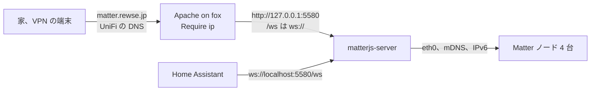

# matterjs-server への移行と matter.rewse.jp 設計

## 目的

fox の Matter コントローラーを python-matter-server から matterjs-server に置き換え、そのダッシュボードを家と VPN から `https://matter.rewse.jp/` で開けるようにする。python-matter-server は上流でアーカイブされ、8.1.2 が最後のリリースになった。matterjs-server は同じ WebSocket API を持つ後継で、Python 版のデータを初回起動時に取り込む。

## 現状

- `roles/matter_server` が `/etc/compose/matter_server/compose.yaml` で `ghcr.io/home-assistant-libs/python-matter-server`（`aged_release` で解決、稼働中は 8.1.0）を動かしている。`network_mode: host`、`apparmor:unconfined`、`/run/dbus` の読み取り専用マウントがあり、データは `/srv/matter_server/data` にある
- 5580 は全インターフェースで認証なしに待ち受けており、家の LAN のどの端末からも WebSocket API を使える
- Home Assistant は `ws://localhost:5580/ws` に接続する。`roles/homeassistant/meta/main.yml` は `matter_server` を依存に持つ
- ノードは 3 Aqara Hub M2、4 SwitchBot Hub 2、5 SwitchBot Hub Mini、8 CANDY HOUSE Hub3 の 4 台で、すべて Wi-Fi か Ethernet。Thread のデバイスはない。Aqara のセンサーは M2 の Matter ブリッジの配下にある
- デバイスはスマホの HA アプリから追加している。fox の Bluetooth は使っていない
- `/srv/matter_server/data` には `chip.json` と `9812021715157225473.json` のほか、`.backup`、`.old`、`chip_config.ini`、`chip_counters.ini`、`chip_factory.ini`、`credentials/` がある。所有者は root で、ほとんどが 0600
- fox の `net.ipv4.ping_group_range` は `1 0` で、だれも非特権の ping を打てない。sysctl のドロップインは raspberrypi ロールが `/etc/sysctl.d` に置き、`Reload sysctl` ハンドラーで反映している
- fox には eth0 のほかに wlan0（DOWN）と docker のブリッジが 7 本ある
- `aa-disable-homeassistant` の撤去後、docker-default の AppArmor プロファイルは有効になっている
- restic は `/` を `--one-file-system` でバックアップしており、`/srv` の下も対象に入る

## ゴール

- matterjs-server が 4 台のノードを引き継ぎ、HA の Matter のエンティティが移行前と同じく使える
- 家と VPN から `https://matter.rewse.jp/` でダッシュボードを開ける
- 5580 に LAN から直接届かない
- 切り替えに失敗したら、手を付けていない Python 版のデータで戻せる

## 範囲外

- ダッシュボードのログイン。接続元を家と VPN に絞るだけにする（ユーザーの判断）。ログインがないので fail2ban のコンポーネントも作らない
- CloudFront での公開、公開 DNS、security-agent の pentest。家と VPN からは UniFi の DNS で fox に直接届くので要らない
- fox の Bluetooth でのコミッショニング（`NOBLE_BINDINGS`、`BLUETOOTH_ADAPTER`）
- Thread、OTA の設定変更、`ENABLE_TIME_SYNC`
- `/srv/matter_server` の削除。移行後しばらく残し、消す時期はユーザーが決める

## 方式

| 方式 | 内容 | 判断 |
|---|---|---|
| A | 新ロール `matterjs_server` は移行後の状態だけを管理する。旧コンテナの停止とデータのコピーは plan に書いた手順で一度だけ手で行う | 採用 |
| B | A の新ロールに、旧データがあって新データがないときだけ旧コンテナを止めてコピーする移行タスクを組み込む | 不採用。一度しか使わない条件分岐と check mode の扱いが増え、移行が済めば消すコードになる |
| C | `roles/matter_server` のイメージだけ差し替え、旧データのディレクトリで起動する | 不採用。余分なファイルが混ざり「Python のデータファイルだけで起動する」という移行の条件を満たせない。無傷の旧データが残らず、ロール名も製品名とずれる |

## 構成

### matterjs_server ロール

- `tasks/main.yml` は sysctl、container、apache の順に import する。container は `update` タグも持つ
- `meta/main.yml` は `docker` と `httpd` を依存にする
- sysctl コンポーネント: `/etc/sysctl.d/` に `net.ipv4.ping_group_range = 0 2147483647` のドロップインを置き、`Reload sysctl` で反映する。値は今の Ubuntu の既定値で、許可されるのは ICMP echo だけである。matterjs-server は ping コマンドでノードの到達を確かめ、コンテナは UID 1000 で動く。ハンドラーは raspberrypi ロールと同じ名前と中身にする
- container コンポーネント
  - `aged_release` で `oci:ghcr.io/matter-js/matterjs-server` を `^\d+\.\d+\.\d+$` で解決し、`tag@digest` で固定する。arm64 と amd64 の選び方は今のロールに合わせる
  - `/srv/matterjs_server/data` を UID と GID 1000、0700 で作る。中身は再帰的に変えない
  - データディレクトリに `chip.json` も `server/` もないときは、起動の前に失敗させる。空のディレクトリで一度起動すると matter.js のデータが先にでき、その後 Python 版のデータを置いても取り込まれなくなる。check mode では失敗させず、`debug` で理由を出して起動を飛ばす
  - `/etc/compose/matterjs_server/compose.yaml` を `name: matterjs_server` で描画する。サービスとコンテナの名前は `matterjs-server` とし、`network_mode: host`、`restart: unless-stopped`、`/srv/matterjs_server/data:/data` を持たせる。`/run/dbus` のマウントと `apparmor:unconfined` は外す
  - 環境変数は `LISTEN_ADDRESS=127.0.0.1,::1`、`PRIMARY_INTERFACE=eth0`、`PRODUCTION_MODE=true` とする。`STORAGE_PATH` と `PORT` は既定値（`/data`、5580）のままにする。`::1` を含めるのは、HA の `localhost` が `::1` に先に解決されることがあるためである。ヘルスチェックは先頭の `127.0.0.1` を見る。インターフェース名と待ち受けのアドレスは `defaults/main.yml` ではなく `vars/main.yml` に置く
  - 旧構成の撤去として、`/etc/compose/matter_server/compose.yaml` があれば `docker_compose_v2` の `state: absent` で止めてから `/etc/compose/matter_server` を消す。`/srv/matter_server` には触れない
- apache コンポーネント: `templates/matter.rewse.jp.conf.j2` を `/etc/apache2/sites-available/matter.rewse.jp.conf` に置き、`a2ensite` で有効にし、`Reload Apache` で反映する。zabbix_mcp の apache コンポーネントと同じ形にする
- vhost の中身
  - `ProxyPass /ws ws://127.0.0.1:5580/ws` を `ProxyPass / http://127.0.0.1:5580/` より前に書く。teslamate の vhost と同じ書き方にする
  - `<Location />` の `Require ip` で、`127.0.0.1`、`::1`、`networks` の `home_private_ipv4`、`home_private_ipv6`、`home_public_ipv4`、`home_public_ipv6`、`aws_private_ipv4`、`aws_public_ipv6` を許可する。zabbix-mcp の一覧から `office_public_ipv4` を除いたものになる。`fox.rewse.jp` には公開の AAAA（`240f:143:f60c:1:…`）があり、家の端末は IPv6 だと `home_public_ipv6` のアドレスから届く（zabbix-mcp の `access.log` でも大半がこの形）。VPN の端末は alfa を経由して `aws_private_ipv4` か `aws_public_ipv6` から届く
  - 証明書は既存の `/etc/letsencrypt/live/rewse.jp/`（`*.rewse.jp`）を使う
- `tests/test_matterjs_server.py` を作り、`tests/test_zabbix_mcp.py` と同じく jinja2 でテンプレートを描画して確かめる。対象は compose の待ち受けがループバックだけであること、`PRIMARY_INTERFACE` と `PRODUCTION_MODE`、dbus と `apparmor:unconfined` がないこと、sysctl の値、vhost の `/ws` と `/` の順序と `Require ip` の一覧、データのガード、旧構成の撤去、コンポーネントの import と依存とする

### 既存のロールと playbook

- `home-primary.yml` の `matter_server` を `matterjs_server` に置き換え、サービスの並び（アルファベット順）に合わせる
- `roles/homeassistant/meta/main.yml` の依存を `matterjs_server` にする
- `roles/matter_server` を消す

### 名前解決とクライアント

- UniFi の DNS ポリシーに `matter.rewse.jp` を `fox.rewse.jp` への CNAME として足す。TTL は zabbix-mcp と同じ扱いにする
- cloudfront-waf、公開 DNS、security-agent は変えない
- chezmoi で `matter.rewse.jp` や `fox.rewse.jp:5580` を参照している設定があれば直す

## 切り替えの順序

1. このリポジトリの変更をコミットし、fox に `--check --diff` を流して差分を確かめる。この時点ではデータがないので、ガードが起動を飛ばしたと報告することを確かめる
2. UniFi の DNS ポリシーを足す
3. fox で旧コンテナを止める（`docker compose -f /etc/compose/matter_server/compose.yaml stop`）。ここから HA の Matter のエンティティが使えなくなる
4. `/srv/matterjs_server/data` を作り、`chip.json` と `9812021715157225473.json` の 2 つだけをコピーして、`chown -R 1000:1000` と `chmod -R u+rwX,go-rwx` をかける
5. playbook を `matterjs_server` のタグで反映する。matterjs-server が起動して移行し、旧 compose が撤去される
6. もう一度流して `changed=0` を確かめる

push、fox への反映、UniFi への書き込みは、それぞれ実施の前にユーザーの確認を取る。

## 検証

- `uv run --with pytest --with ansible-core pytest tests` と pre-commit を通す
- `docker logs matterjs-server` で移行の完了を確かめる。初回の「no addresses known」は想定どおりなので、全ノードのインタビューが終わるまで待つ
- 4 台のノードと M2 配下のセンサーが HA で available になる
- 鍵（CANDY HOUSE Hub3 配下）の施錠と解錠が HA からできる
- 家の端末と VPN の端末で `https://matter.rewse.jp/` のダッシュボードが開き、ノードの一覧が出る
- 家の Mac から `fox.rewse.jp:5580` に IPv4 でも IPv6 でも接続できない
- `sysctl net.ipv4.ping_group_range` が `0 2147483647` を返し、ダッシュボードか HA からノードへの ping が通る
- コンテナのヘルスチェックが healthy になる

## 戻し方

1. matterjs-server を止める（`docker compose -f /etc/compose/matterjs_server/compose.yaml down`）
2. このリポジトリの変更を revert し、`matter_server` のタグで反映する。Python 版は手を付けていない `/srv/matter_server/data` で起動する
3. 移行後に追加したノードを残したいときは、2 の前に `/srv/matterjs_server/data/9812021715157225473.json` を旧ディレクトリに戻す。matterjs-server はノードの追加と削除のたびにこのファイルを更新するが、追加したノードの属性は書かないので、Python 版が再インタビューする。matterjs-server で消したノードは戻らない

Python 版と matterjs-server を同じデータで同時に動かさない。同じファブリックの同じコントローラーとして、同じノードに矛盾する要求を送るためである。

## 設計時に決めたこと

会話で確かめておらず、設計の段階で決めたもの。

- ロール名を `matterjs_server`、データを `/srv/matterjs_server` にした。製品名に合わせる規約による
- ping の sysctl を raspberrypi ロールではなく matterjs_server ロールに置いた。必要とするのはこのサービスだけで、ロールを外せば理由ごと消える
- `apparmor:unconfined` を外し、docker-default のプロファイルで動かす。BLE を使わないので dbus への経路が要らない。ping か mDNS が止められたら、そのときに外す理由をコメントに書いて戻す
- 許可する接続元を、zabbix-mcp の一覧から会社を除いた家と VPN の全範囲にした。家の端末が IPv6 の公開アドレスから来るので、private だけでは足りない
- 旧構成の compose は新ロールの撤去タスクで消し、データは残す
- 環境変数で済む設定は CLI 引数ではなく環境変数で渡す

## 実装者に任せること

- sysctl のドロップインのファイル名
- データのガードの書き方（`stat` と `fail` か `assert` か）
- vhost とタスクのコメントの文面
- テストの関数の分け方
- UniFi の DNS ポリシーを UI と Site Manager API のどちらで足すか
