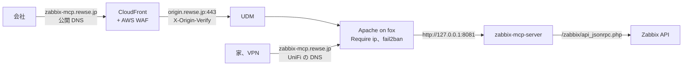

# zabbix-mcp-server の HTTPS 化 設計

## 目的

fox の zabbix-mcp-server を `https://zabbix-mcp.rewse.jp/mcp` で使えるようにし、家、VPN、会社から接続できるようにする。今は平文の HTTP で待ち受けており、Zabbix に書き込めるベアラートークンと監視データが LAN を暗号化されずに流れている。会社からは経路がなく使えない。

## 現状

- zabbix-mcp-server（initMAX/zabbix-mcp-server 1.37.1）は `0.0.0.0:8081` で HTTP を待ち受ける。`public_url` は `http://fox.rewse.jp:8081` で、`auth_token` のベアラートークンで認証する。`read_only = false` なので Zabbix に書き込める
- 8081 はポートフォワードしておらず、家の中からしか届かない
- 利用者は mcporter だけで、chezmoi の `dot_config/mcporter/private_mcporter.json.tmpl` が `http://fox.rewse.jp:8081/mcp` を指す。この設定は会社の端末（ホスト `7cf34ded5d65`）にも配られる
- `[reporting] download_urls = false` は fox に反映済みである
- 公開しているホスト名（`rewse.jp` と 9 個のサブドメイン）は `~/git/cloudfront-waf` の CloudFront と WAF を通る。家の中と VPN からは UniFi の DNS ポリシーで fox の内部アドレスに直接届く。Apache は CloudFront の秘密のヘッダーがないリクエストを、ループバック、家、VPN 以外から来たものは 403 にする（`roles/httpd/templates/cloudfront-origin.conf.j2`）。`mod_remoteip` が CloudFront 経由の接続元を復元するので、`Require ip` と fail2ban は本当の接続元を見る
- 会社の出口アドレスは `networks.office_public_ipv4` にあり、`/zabbix` と `/admin` はこれを許可している。fox の `access.log` には 10/21 までの会社のアドレスからの 200 が残っている。10/22 の CloudFront への切り替え後は会社からのリクエストがまだなく、CloudFront 経由で会社から使えるかは確かめていない

## ゴール

- 家、VPN、会社から `https://zabbix-mcp.rewse.jp/mcp` で mcporter が使える
- トークンと応答が平文で流れない
- 許可した接続元以外からは、トークンを持っていても使えない
- トークンの総当たりを fail2ban が止める
- `*.rewse.jp` のサブドメインを増やすときに手を入れる場所を AGENTS.md に書く

## 範囲外

- Zabbix の画面と API の公開範囲。画面はすでに会社からのアクセスを許可しており、API は fox の中の zabbix-mcp-server からしか使わない
- OAuth への切り替えとトークンの更新
- WAF の `BlockManagedRules` の有効化
- matter.rewse.jp（別の spec で扱う）
- security-agent の pentest の追加。接続元を絞るので外から pentest が届かない。同じく接続元を絞っている zabbix.rewse.jp にも pentest はない

## 方式

| 方式 | 内容 | 判断 |
|---|---|---|
| A | Apache で TLS を終端し、CloudFront 経由でも公開する。Apache で接続元を家、VPN、会社に絞る | 採用 |
| B | A と同じく公開するが、接続元は絞らず、トークン、fail2ban、WAF だけで守る | 不採用。書き込めるトークン 1 つでインターネットに開くことになる |
| C | zabbix-mcp-server 自身で TLS を終端する（`tls_cert_file`、`tls_key_file`） | 不採用。秘密鍵をサービスのユーザーにも読ませる必要があり、証明書の更新時に再起動する仕組みも要る。会社からの経路もできない |
| D | 公開せず、会社から家の VPN を張る | 不採用。会社のネットワークから VPN を張れるかに左右される |

A は `/zabbix` と `/admin` と同じ守り方で、litellm や filebrowser と同じ Apache の vhost の形になる。トークンが漏れても、家と会社の外からは使えない。出先やテザリングからはつながらない。

## 構成

### zabbix_mcp ロール

- `vars/main.yml` に `zabbix_mcp_hostname: zabbix-mcp.rewse.jp` と `zabbix_mcp_port: 8081` を置き、`zabbix_mcp_public_url` を `https://{{ zabbix_mcp_hostname }}` にする。ホスト名とポートは設定、vhost、fail2ban の複数のテンプレートで使う
- `config.toml.j2` は `host = "127.0.0.1"` にする。`auth_token` は引き続き必須とし、ガードの文言を「Apache が LAN と会社に公開するので必須」という趣旨に直す。`download_urls = false` のコメントから平文の HTTP の理由を外す
- apache コンポーネントを足す。`templates/zabbix-mcp.rewse.jp.conf.j2` を `/etc/apache2/sites-available/zabbix-mcp.rewse.jp.conf` に置き、`a2ensite` で有効にし、`Reload Apache` で反映する。filebrowser の apache コンポーネントと同じ形にする
- vhost の中身
  - `ProxyPreserveHost on`。zabbix-mcp-server は `public_url` のホスト名と一致しない Host ヘッダーを拒否する
  - `ProxyPass / http://127.0.0.1:8081/ flushpackets=on`。Streamable HTTP の応答は server-sent events になることがあり、Apache が都度送り出さないとクライアントに届かない
  - `<Location />` の `Require ip` で、`127.0.0.1`、`::1`、`networks` の `home_private_ipv4`、`home_private_ipv6`、`home_public_ipv4`、`home_public_ipv6`、`aws_private_ipv4`、`aws_public_ipv6`、`office_public_ipv4` を許可する
  - 証明書は既存の `/etc/letsencrypt/live/rewse.jp/`（`*.rewse.jp`）を使う
- fail2ban コンポーネントを足す。フィルタは `zabbix-mcp.rewse.jp` の vhost で `/mcp` に 401 が返った行に一致させ、`/.well-known/` は対象外とする（クライアントがトークンを送る前に読む）。ジェイルは filebrowser と同じく `backend = auto`、`action = %(action_)s` と `apache-deny`、`logpath = /var/log/apache2/other_vhosts_access.log` とする
- `meta/main.yml` を作り、`fail2ban` と `httpd` を依存にする
- `tasks/main.yml` の並びは user、app、service、apache、fail2ban とする
- `tests/test_zabbix_mcp.py` を作り、`tests/test_filebrowser.py` と同じく jinja2 でテンプレートを描画して確かめる。待ち受けがループバックだけであること、`public_url` が https の vhost であること、`download_urls` が false であること、vhost のプロキシ先、コンポーネントの import と依存、ジェイルの設定、フィルタが一致する行と一致しない行を対象にする

### zabbix_server ロール

`roles/zabbix_server/templates/zabbix-api.conf.j2` のコメントにある「MCP のポートは外に出していないので、家の外のクライアントには経路がない」という記述を、今の構成に合わせて直す。会社のクライアントは Apache を通って zabbix-mcp-server に届き、zabbix-mcp-server は fox の中から API を呼ぶので、API の許可範囲は変えない。

### cloudfront-waf

- `infra/template.yaml` の `Aliases` に `zabbix-mcp.rewse.jp` を足す。証明書は `*.rewse.jp` を含むので作り直さない
- `scripts/switch-dns.sh` の `SUBDOMAINS` に `zabbix-mcp` を足す。UPSERT なので、`cloudfront` で流すと新しい CNAME ができ、ほかのレコードは今の値のまま上書きされる
- `tests/test_template.py` と `tests/test_switch_dns.py` の一覧を直す
- README と `docs/setup.md` にある公開名の数と一覧（10 個、9 個のサブドメイン、図のラベル）を直す
- README の「Turn on blocking」に、MCP の通信が誤検知されていないことを WAF のログで確かめてから有効にする旨を足す
- オリジンの応答待ち（`OriginReadTimeout`）は 60 秒のままにする。会社からは 60 秒を超えるツールの呼び出しが切れる

### 名前解決

- 公開 DNS: `AWS_PROFILE=admin scripts/switch-dns.sh cloudfront` で Route 53 に CNAME を作る
- 内部 DNS: UniFi の DNS ポリシーに `zabbix-mcp.rewse.jp` を `fox.rewse.jp` への CNAME として足す。ほかのサービス名と同じ形にする

### クライアント

chezmoi の `dot_config/mcporter/private_mcporter.json.tmpl` の `zabbix` の URL を `https://zabbix-mcp.rewse.jp/mcp` にし、mcporter を使う各端末で `chezmoi apply` する。

### AGENTS.md

このリポジトリの AGENTS.md に、`*.rewse.jp` のサブドメインを足すときに手を入れる場所を英語で書く。規約は 1 か所にまとめ、cloudfront-waf と security-agent の AGENTS.md には書かない。

- このリポジトリ: サービスのロールの apache コンポーネント（`<name>.rewse.jp.conf.j2` の vhost）。ログインがあれば fail2ban コンポーネント。接続元を絞るなら `networks` を使った `Require ip`
- cloudfront-waf: `Aliases`、`scripts/switch-dns.sh` の `SUBDOMAINS`、テスト、README と `docs/setup.md` の一覧。反映はスタックのデプロイと `switch-dns.sh cloudfront`
- UniFi: `fox.rewse.jp` への CNAME の DNS ポリシー
- security-agent: インターネットのどこからでも届く名前には、月次の pentest（`targets.toml` と `infra/template.yaml`、ターゲットドメインの検証）。接続元を絞る名前には作らない
- chezmoi: その URL を参照するクライアントの設定

## 切り替えの順序

1. cloudfront-waf の変更をコミットし、スタックをデプロイしてから `switch-dns.sh cloudfront` を流す。この時点では fox に vhost がないので、CloudFront 経由のリクエストは Apache の既定の vhost（`rewse.jp`）に当たる
2. UniFi の DNS ポリシーを足す
3. このリポジトリの変更をコミットし、fox に `zabbix_mcp` と `zabbix_server_frontend` を反映する。ここで 8081 は外から使えなくなる
4. chezmoi の変更をコミットし、各端末で `chezmoi apply` する。3 からここまでの間、MCP はつながらない

AWS、UniFi、chezmoi への書き込みは、それぞれ実施の前にユーザーの確認を取る。

## 検証

- このリポジトリで `uv run --with pytest --with ansible-core pytest tests` と pre-commit、cloudfront-waf で `uv run pytest -q`、`uv run cfn-lint infra/template.yaml`、pre-commit を通す
- fox は `--check --diff` で差分を見てから反映し、もう一度流して `changed=0` を確かめる
- 家の中から `https://zabbix-mcp.rewse.jp/health` が 200、トークンなしの `/mcp` が 401 を返し、mcporter から zabbix のツールを呼べる
- CloudFront 経由（CloudFront のアドレスに `curl --resolve` する）で、家の公開アドレスからは `/health` が 200、alfa の公開 IPv4 のように許可していないアドレスからは 403 を返す
- LAN から `fox.rewse.jp:8081` に接続できない
- `fail2ban-client get zabbix-mcp logpath` が Apache のログを指し、`fail2ban-regex` が 401 の行だけに一致する
- 会社からの接続は、次に出社したときにユーザーが確かめる。同じ CloudFront の経路を通る Zabbix の画面（`https://zabbix.rewse.jp/zabbix/`）も開けることを合わせて確かめる

## 戻し方

このリポジトリと chezmoi の変更を revert して反映すれば、8081 の HTTP に戻る。CloudFront の別名、公開 DNS、UniFi の DNS ポリシーは残しても害がないので、必要になったときに消す。

## 設計時に決めたこと

会話で確かめておらず、設計の段階で決めたもの。

- ホスト名を `zabbix-mcp.rewse.jp` にした
- 許可する接続元を `/admin` と同じ範囲にし、ループバックと `home_private_ipv6` を足した。VPN の alfa は `aws_private_ipv4` から届く
- CloudFront の 60 秒の応答待ちは変えない。ほかのサービスと共有の設定で、Zabbix のツール呼び出しは通常それより短い
- サブドメインの規約はこのリポジトリの AGENTS.md だけに書く
- security-agent の pentest は足さない

## 実装者に任せること

- vhost、フィルタ、ジェイルのコメントの文面
- テストの関数の分け方
- UniFi の DNS ポリシーを UI と Site Manager API のどちらで足すか
- `--resolve` に使う CloudFront のアドレスと、許可していないアドレスからの確認に使うホスト
