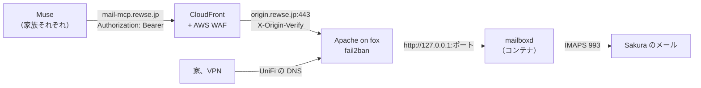

# Muse から Sakura のメールを使う MCP サーバー 設計

## 目的

Meta Muse から Sakura のメール（rewse.jp、MX `rewse.sakura.ne.jp`）を読み、迷惑メールを判定して移動、削除できるようにする。家族もそれぞれの Muse から自分のメールボックスに同じことができるようにする。家族が使えることが一番の目的である。

今は利用者の Muse だけが、Muse の Mac アプリを通して Mac Studio の Mail.app を読んでいる。この経路には三つの問題がある。家族の Muse は利用者の Mac を経由できない。Mac のスリープ、再起動、アップデートの間は読めない（Mac Studio は今はスリープしない設定だが、スリープさせたい）。Muse にフルディスクアクセスを渡す必要がある。

Muse の Secure Credentials Store は HTTPS のリクエストにしか資格情報を差し込まない。Sentinel が外向きの通信の境界で代わりの値を本物に置き換える仕組みで、IMAP のログインには使えない。そこで、常時動いている fox に HTTPS の MCP サーバーを置き、Muse からはベアラートークンだけで使えるようにする。

## ゴール

- Mac の状態に関係なく、Muse から `https://mail-mcp.rewse.jp/mcp` でメールの一覧、検索、読み取り、フォルダー移動、ゴミ箱への移動、下書きの作成ができる
- 家族 3 人それぞれに別のトークンを発行し、各トークンでは本人のメールボックスにしか触れない
- トークンを持っていても、メールの送信とゴミ箱からの完全削除はできない。消したメールはゴミ箱から取り戻せる
- トークンの総当たりを fail2ban が止める
- 誰がいつ何をしたかが監査ログに残る

## 範囲外

- メールの送信と直接の返信。Muse が迷惑メールの文面にだまされても、外にメールを出させない。返信は下書きまでとし、送るのは本人がメールソフトから行う
- ゴミ箱からの完全削除。ゴミ箱を空にするのは Sakura の保存期間か本人の操作に任せる
- 新着メールの webhook（docker-mailbox の `watch`）
- 迷惑メールの判定ロジック。判定は Muse が行い、サーバーは道具を渡すだけとする
- OAuth による認可。Muse はベアラートークンをヘッダーに差し込めるので要らない
- Mac 経由の今の仕組みの撤去。新しい経路で動くのを確かめてから利用者が判断する
- WAF の `BlockManagedRules` の有効化

## 制約

- Muse の接続元は Meta のクラウドで、アドレスがわからない。zabbix-mcp のように `Require ip` で絞れず、インターネット全体に公開することになる
- Muse のアプリには MCP サーバーの URL を登録する画面がない。チャットで「この MCP サーバーにつなぐカスタムコネクタを作って」と頼み、トークンは Muse が開く入力欄から Secure Credentials Store に入れる。Meta はこの使い方を公式には説明していないが、Muse から TickTick の MCP は使えている
- 家族全員の Sakura のパスワードは利用者が管理しており、サーバーにまとめて置いてよい
- CloudFront のオリジン読み取りタイムアウトは 60 秒で、それより長いリクエストは失敗する
- docker-mailbox はスター 7、v0.8.0（2026-10-27）の若いプロジェクトで、更新が速い。ライセンスは WTFPL

## 方式

| 方式 | 内容 | 判断 |
|---|---|---|
| A | psyb0t/docker-mailbox を fox のコンテナで動かし、Apache の vhost と CloudFront で公開する。トークンごとに権限とメールボックスを絞る | 採用 |
| B | n24q02m/better-email-mcp を同じ形で公開し、OAuth 2.1 で認可する | 不採用。ユーザーごとに操作の権限を絞れず、Muse がだまされたときに送信までできてしまう。OAuth の認可サーバーも抱えることになる |
| C | IMAP の MCP サーバーを自作する | 不採用。必要な機能は A にそろっている |

A は、トークンごとにできる操作（`read`、`organize`、`delete` など）と触れるメールボックスを設定ファイルで決められ、REST と MCP の両方に同じ制限がかかる。若いプロジェクトであることは、`aged_release` の待機期間とイメージのダイジェスト固定、更新前の CHANGELOG の確認で補う。

## 構成



### mailboxd ロール

新しいロール `mailboxd` を作り、fox の playbook に加える。名前は docker-mailbox のデーモン名に合わせた。`roles/filebrowser` を手本にし、コンポーネントは config、container、apache、fail2ban とする。

- container コンポーネント
  - イメージは `aged_release` の `oci:psyb0t/mailbox` で `^v\d+\.\d+\.\d+$` に一致するタグを選び、`tag@digest` で固定する。Docker Hub には amd64 と arm64 がある。`latest` と `sha-*` のタグは使わない
  - Compose プロジェクトは `/etc/compose/mailboxd/compose.yaml`。上流の `docker-compose.yml` の守り（`read_only`、`cap_drop: [ALL]`、`no-new-privileges`、tmpfs の `/tmp`、メモリと PID の上限、ヘルスチェック）を引き継ぐ。`watch` サービスは含めない
  - 待ち受けは `127.0.0.1` のみ。ポートは fox で空いているものを選ぶ
  - 状態の SQLite（監査ログ、チェックポイント）は `/srv/mailboxd` をバインドマウントして残す
- config コンポーネント
  - `config.yaml` に、メールボックスとトークンの定義を描画する。パスワードとトークンは `${VAR}` で参照し、値は `.env`（`env_file`）に描画する。`.env` は root だけが読める権限にし、Docker が root で読んでコンテナに渡す
  - メールボックスは家族一人に一つ。IMAP は `rewse.sakura.ne.jp:993`、`tls: ssl`
  - 下書きを作るには `smtp` の設定が要る。docker-mailbox は下書きの差出人を `smtp.from_address` から決め、`smtp` のないメールボックスでは下書きの作成を拒否する。そこで `smtp` は差出人のためだけに置き、送れない値にする。`host` は名前解決できない `smtp.invalid`（RFC 2606）、`password` は本物ではない固定の文字列とし、Sakura の SMTP の資格情報はサーバーに置かない
  - `send_guard.dry_run: true` にする。送信をトークンの権限、届かない SMTP の設定、dry run の三つで止める
  - トークンは家族一人に一つ。`scopes: [read, draft, organize]`、`mailboxes` は本人のメールボックスだけにする。`send`、`delete`、`admin` は付けず、`"*"` も使わない。ゴミ箱への移動は `organize` に含まれ、`delete` はゴミ箱からの完全削除の権限である。`draft` は IMAP の下書きフォルダーに書くだけで、`send` と `smtp` がないので送信には使えない
  - トークンの文字列形式（すべての権限とすべてのメールボックスを許す）は使わない
  - `auth.trusted_authserv_id` は、Sakura が受信メールに付ける `Authentication-Results` の値にする。Muse が SPF、DKIM、DMARC の結果を迷惑メールの判定に使えるようにするため
- apache コンポーネント
  - `templates/mail-mcp.rewse.jp.conf.j2` を置き、zabbix-mcp の vhost と同じく `ProxyPreserveHost on` と `ProxyPass ... flushpackets=on` で `127.0.0.1` に流す。`Require ip` は付けない
  - 証明書は既存の `*.rewse.jp` を使う
- fail2ban コンポーネント
  - フィルタは `mail-mcp.rewse.jp` の vhost で `/mcp` に 401 が返った行に一致させる。docker-mailbox は `/health` 以外のすべてのパスでトークンを求め、`/.well-known/` にも 401 を返すが、MCP クライアントがトークンを送る前に読むことがあるので対象外とする
  - ジェイルの形は filebrowser と zabbix-mcp に合わせ、`tests/test_fail2ban_apache.py` の一覧に加える
  - Muse の接続元は家族で共有している可能性がある。誤ったトークンで BAN されると家族全員が一時間使えなくなるが、許容する
- 1Password
  - 3 アカウントの Sakura のパスワードはすでに 1Password にある。Ansible のサービスアカウントは `ansible` vault しか読めないので、その外にあれば `ansible` vault に移すか複製する（どちらにするかは利用者に確かめる）
  - 家族それぞれの MCP トークンは `ansible` vault に新しく作る。コミットするのは Secret Reference だけにする。項目名は `System - Consumer` の規則に従う
  - このリポジトリは公開しているので、家族のメールアドレスと名前はコミットしない。アドレスは Sakura の項目の `username` から実行時に読み、メールボックス名はアドレスのローカル部から作る
  - トークンは `openssl rand -hex 32` で作る。トークンの値は、本人が Muse の入力欄に入れるために 1Password から渡す
- テスト
  - `tests/test_mailboxd.py` で、テンプレートを描画して確かめる。待ち受けがループバックだけであること、どのトークンも `send`、`delete`、`admin` を持たず、`mailboxes` が一つだけであること、`smtp.host` が `smtp.invalid` であること、`send_guard.dry_run` が true であること、`.env` の権限、vhost のプロキシ先、ジェイルの設定、フィルタが一致する行と一致しない行を対象にする

### 他のリポジトリと DNS

AGENTS.md の「Subdomains」の手順に従う。

- `~/git/cloudfront-waf`: `mail-mcp.rewse.jp` を CloudFront の別名と `SUBDOMAINS` に加え、テストと文書の名前の一覧と数を直してデプロイする。デプロイと DNS の切り替えは、自宅の Mac から `AWS_PROFILE=cloudfront-waf-deploy` で行う
- UniFi: `mail-mcp.rewse.jp` を `fox.rewse.jp` に向ける CNAME の DNS ポリシーを加える
- `~/git/security-agent`: インターネットから誰でも届く名前なので、毎月のペネトレーションテストに加え、対象ドメインを検証する
- `~/git/chezmoi`: クライアント設定に URL を書く場所はないので変更しない

### 更新

`update` タグで `aged_release` が新しいタグを選ぶ。v0 のうちは minor の更新でも設定の互換性が崩れることがあるので、新しいタグを入れる前に上流の CHANGELOG と移行ノート（`docs/operations.md`）を読む。

## 進め方

インターネットに常設で公開する作業（cloudfront-waf と security-agent）の前に、Muse から本当に使えるかを確かめる。

1. fox に `mailboxd` ロールを入れる。3 アカウントとも設定するが、この段階では利用者のトークンだけを使う。Apache の vhost と fail2ban もこの段階で入れ、家から確かめる
2. 一時的な HTTPS のトンネルで Muse から確かめる。fox の Apache は CloudFront のヘッダーがないインターネットからのリクエストを 403 にするので、CloudFront を使わずに外から届かせるには別の経路が要る。Cloudflare の Quick Tunnel（`cloudflared tunnel --url http://127.0.0.1:<ポート>`、アカウント不要、`*.trycloudflare.com` のランダムな名前）を fox で手で起動し、`127.0.0.1` の mailboxd に直接つなぐ。トンネルは Ansible で管理せず、確かめ終わったらすぐ止める。この経路には Apache と fail2ban が入らないが、トークンの認証は効いている。Muse に作らせたコネクタは URL だけを差し替えて段階 3 でも使う
3. 段階 2 が通ったら、cloudfront-waf、UniFi の DNS、security-agent を入れ、Muse のコネクタの URL を `https://mail-mcp.rewse.jp/mcp` に替える
4. 家族 2 人の Muse にコネクタを作る

段階 2 が通らなければ、段階 3 には進まず「残るリスク」の代わりの方法を考える。

## 確かめること

- 段階 1: 家から `/health` が 200、トークンなしの `POST /mcp` が 401 を返す。利用者のトークンで、ほかの家族のメールボックスを指定すると拒否される。送信と完全削除の道具は、一覧に出ないか、呼ぶと拒否される
- 段階 2: Muse にカスタムコネクタを作らせ、利用者のメールボックスで一覧、検索、読み取り、フォルダー移動、ゴミ箱への移動、下書きの作成ができる。送信と完全削除は拒否される
- 段階 3: CloudFront 経由で Muse から段階 2 と同じことができる。WAF のログで、Muse の通信が管理ルールに誤検知されていないことを見る
- 段階 4: 家族の Muse でも段階 2 と同じことができ、ほかの家族のメールボックスは見えない

## 残るリスク

- Muse がベアラートークンの MCP サーバーにつなげない場合。TickTick の MCP は使えているが、認証方式が OAuth なら条件が違う。つながらなければ、Muse に REST API（同じポートの HTTP API）向けのコネクタを作らせる。それも駄目なら、方式 B の OAuth を考え直す
- docker-mailbox の開発が止まる、または互換性のない変更が続く場合。イメージを固定しているので急に壊れはしない。自作か別の実装への乗り換えを、その時点で判断する
- 家族全員の Sakura のパスワードが fox の一か所に集まる。fox が侵害されたときの影響は大きい

## 実装者に任せること

- 待ち受けのポート番号
- 1Password の項目の作り方と項目 ID
- 家族のメールボックスとトークンを並べる変数の形
- `/srv/mailboxd` をバックアップの対象に加えるかどうか
- `limits` と `log_level` の値

## 付録: 段階 2 で Muse に渡すプロンプト

事前に、件名に「mailboxd テスト」を含むメールを自分のアドレスに送っておく。`<トンネルの名前>` は cloudflared が表示した名前に、`<メールボックス名>` は `config.yaml` の `name` に置き換える。段階 3 では URL だけを替えるよう Muse に頼む。

```text
Sakura のメール用のカスタムコネクタを作ってほしい。

- 接続先はリモートの MCP サーバー。トランスポートは Streamable HTTP で、URL は https://<トンネルの名前>.trycloudflare.com/mcp
- すべてのリクエストに Authorization: Bearer <トークン> ヘッダーを付ける。トークンは MAILBOXD_TOKEN という名前で Secure Credentials Store に保存したいので、安全な入力欄を開いて。チャットには貼らない
- 公式の MCP SDK でクライアントを書き、initialize のあと tools/list で使える道具の一覧を見せて
- 道具の mailbox 引数には <メールボックス名> を指定する。このトークンで触れるのはこのメールボックスだけで、送信とゴミ箱からの完全削除はできない設定になっている

道具の一覧が見えたら、次の順に試して、それぞれの結果を見せて。
1. INBOX の新しいメール 5 件の差出人、件名、日時
2. 件名に「mailboxd テスト」を含むメールの検索
3. そのメールの本文と、SPF、DKIM、DMARC の判定結果
4. そのメールを迷惑メールのフォルダーに移動し、次に INBOX に戻す
5. そのメールへの返信を下書きとして保存する（送信はしない）
6. そのメールをゴミ箱に移動する
7. 送信と完全削除の道具が一覧にないか、呼ぶと拒否されることを確かめる。送信を試すときの宛先は自分のアドレスにする

最後に、このコネクタの使い方をスキルとして保存して。URL はあとで差し替えるので、1 か所で変えられるようにしておいて。
```
