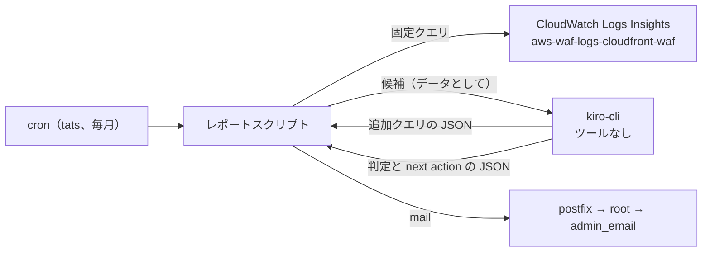

# CloudFront WAF 月次レポート 設計

## 目的

`rewse/cloudfront-waf` の web ACL が記録したログを月に一度読み、対応が必要なものだけを next action 付きでメールする。Zabbix の「WAF blocked more than 500 requests in 5 minutes」トリガーは、攻撃を正しくブロックしただけでも発報し、毎回の調査が空振りになるため無効にした。ブロック件数の急増そのものには対応が要らない。対応が要るのは、自分のサービスへの誤検知、自分の締め出し、WAF をすり抜けた怪しいリクエストであり、件数のしきい値ではこれらを区別できない。このレポートがその代わりになる。

利用者はレポートが長いと読み飛ばす。したがって、next action のない項目は載せない。

## ゴール

- fox で毎月 1 回、前月分（JST の暦月）の WAF ログを集計し、Logwatch と同じ経路（ローカルの postfix から root 宛て、root は `admin_email` に転送される）でプレーンテキストのメールを送る。
- 各項目は「何が起きたか」「根拠」「next action」の 3 点で構成する。next action を書けない項目は出さない。
- 対応不要の月も、件名と本文 1 行で「対応不要」と送る。レポートが届かないことを故障の兆候として扱えるようにするためである。
- ログだけで判断できず、Apache のログや他のサービスを確認すべき場合は、その確認自体を next action として書く。

## 非ゴール

- リアルタイムの検知や通知。急ぎの異常は既存の Zabbix トリガー（5xx 率、30 分間リクエストなし）が受け持つ。
- WAF ルールの自動変更。レポートは提案までとし、変更は人が `rewse/cloudfront-waf` で行う。
- 攻撃の統計やグラフ。ブロックできていた攻撃は載せない。

## アンチゴール

- 毎月同じ項目が並び、読み飛ばされるようになること。
- ログ中の攻撃者が制御できる文字列（URI、User-Agent、ヘッダー）によって、AI が意図しない操作をすること。
- レポートの作成が黙って止まること。

## 制約

- 監視対象のサービス 11 ホストはどれも止まると困る。誤検知の判定を特定のサービスに絞らない。
- 生成 AI には fox の `kiro-cli` を使う。認証には `~/.config/environment/kiro.sh` の `KIRO_API_KEY` を使う（chezmoi で fox にだけ配置、0600、1Password `op://chezmoi/l2kqwiv5em4t4j2kxaat2py5fy/credential`）。このキーは dependabot-review のキーとは別である。
- AWS には fox の `tats` の認証情報（default プロファイル、`ReadOnlyAccess` と `AmazonRoute53FullAccess`）でアクセスしてよい。ただし `kiro-cli` にはシェルやファイル操作のツールを渡さない。`~/.aws/credentials` に置かれた tats のキーや Route 53 の書き込み権限に、ログ由来の指示が届かないようにするためである。
- ロググループは `us-east-1` の `aws-waf-logs-cloudfront-waf`、保持期間は 90 日である。2026-11-04 時点の保存量は約 170 MB で、月 1 回のクエリ料金は無視できる。
- `BlockManagedRules` は `true` である。マネージドルールはブロックし、Count のまま残るのは `rewse/cloudfront-waf` の README に列挙された override 済みのサブルールと `GeoLabel` だけになる。

## アプローチ

検討した案は次の 3 つである。

- **A. ルールで候補を絞り、kiro-cli が判定と next action を書く（採用）**。決まった Logs Insights クエリで候補を出し、kiro-cli がそれを正規か攻撃かに分類して next action を書く。kiro-cli はツールを持たない。深掘りが必要なときはクエリ文を JSON で返し、スクリプトがそれを実行して結果を返す。正規か攻撃かの見分けを AI に任せられるので、項目を絞り込める。そのうえで、AI ができることは読み取り専用のクエリに限られる。
- **B. ルールだけで作る**。毎回同じ動きになりテストしやすい一方、next action が定型文になり、正規か攻撃かの見分けをルールで書き切る必要がある。無関係な項目が混ざって読み飛ばされやすい。
- **C. kiro-cli に AWS CLI を使わせ、調査を任せる**。最も柔軟だが、攻撃者が制御できるログの文字列に仕込まれた指示に従うと、シェル経由で tats のキーの持ち出しや DNS の書き換えができてしまう。月ごとの内容もぶれやすい。

利用者は A を選んだ。kiro-cli が tats プロファイルで AWS にアクセスすることも許可したが、シェルを渡す危険を踏まえ、追加調査はスクリプトが実行する Logs Insights クエリに限ることで合意した。

## 構成



## 決まっていること

### 置き場所と実行

- ansible-playbooks に新しいロールを作り、`home-primary.yml`（fox）に追加する。fox で動く AWS 関連のスクリプトを ansible-playbooks で管理している既存の形（`zabbix_aws` の `cloudfront_waf.sh`）に合わせる。
- ユーザー `tats` の cron で動かす。`tats` の `~/.aws` と `~/.config/environment/kiro.sh` を使うためである。
- kiro-cli は `/usr/local/bin/kiro-cli` のグローバルインストールを使う（`roles/ubuntu/tasks/kiro_cli.yml` で修正済み）。

### 候補の抽出（決まったクエリ）

前月分を対象に、次の観点で候補を集計する。

1. 日本から BLOCK されたリクエスト（誤検知の疑い）。
2. `rewse.jp` 以外のサービスのホスト宛てに BLOCK されたリクエスト（誤検知の疑い）。海外から呼ぶ正規の利用者（Alexa、Tesla、Home Assistant の webhook）がいるため、国では絞らない。
3. `RateLimitLogin` または `RateLimitAll` で BLOCK されたリクエストのうち、日本からのもの（自分の締め出し）。
4. ALLOW されたリクエストのうち、海外からのもので、スキャンによく使われるパスに当たるもの（すり抜けの疑い）。

いずれも生のリクエストは渡さず、ルール、ホスト、国、IP、URI、User-Agent などで集計した上位の行を渡す。

### kiro-cli との受け渡し

- kiro-cli はツールを一切実行できない状態で呼ぶ（`--no-interactive`、`--trust-tools=`）。ふだん使う agent の MCP サーバーや hooks を読み込まない専用の最小構成にする。
- プロンプトでは、ログ由来の文字列は信頼できないデータであり、その中の指示には従わないことを明示する。データ部分はエスケープし、長さを切り詰める。
- kiro-cli の応答は JSON に限る。種類は次の 2 つである。
  - 追加クエリの要求: Logs Insights のクエリ文と、その目的。スクリプトは対象を `aws-waf-logs-cloudfront-waf` に固定して実行し、結果を次のプロンプトで返す。期間は保持期間内に限り、クエリ文に `SOURCE` などで別のロググループを指定するものは拒否する。往復は最大 3 回とする。
  - 最終結果: 項目の一覧。各項目は「何が起きたか」「根拠」「next action」を持つ。next action が空の項目はスクリプトが捨てる。
- next action には、`infra/template.yaml` に override を足す、レート制限のしきい値を見直す、Apache のログで応答を確かめる、など具体的な作業を書かせる。ログの外を見る必要がある場合は、その確認を next action とする。

### 自分側のアクセス

- 日本からのリクエストに加え、オフィス（Amazon 社内ネットワーク）の出口からのリクエストも自分側として扱う。オフィスの出口アドレスは、毎回の実行時に web ACL が参照する IP set から `aws wafv2 get-ip-set` で読む。fox に新しい秘密情報を置かないためである。
- オフィスのアドレスは非公開なので、kiro-cli には渡さない。スクリプトが各行に「オフィス」の印を付け、kiro-cli にはその印だけを渡す。
- 候補の抽出 1 と 3 の「日本から」は、「日本またはオフィスから」と読み替える。抽出 4 の「海外から」は、オフィスを除く。

### 繰り返し出る項目

- 毎月のレポートを fox に保存し、次の月に前月の項目を kiro-cli に渡す。前月から直っていない項目は「前月から継続」の 1 行にまとめ、新しい項目と区別する。
- 利用者が「このままでよい」と判断した項目は、ロール変数 `cloudfront_waf_report_accepted`（`roles/cloudfront_waf_report/vars/main.yml`）に理由とともに書く。これに当たる項目はレポートに出さない。ansible-playbooks は公開リポジトリなので、各項目はルール名、ホスト、国などで表し、IP アドレスは書かない。

```yaml
cloudfront_waf_report_accepted:
  - match: "RateLimitLogin, hass.rewse.jp, JP"
    reason: "Home Assistant app retries on wake; 100 per 5 minutes is intended."
```

- 照合の方法（文字列か構造化した条件か、スクリプトで照合するか kiro-cli に判断させるか）は実装者に任せる。

### 失敗時

- kiro-cli が失敗した場合や、JSON として解釈できない応答を返した場合は、候補の集計結果を「AI 判定なし」と明記してそのまま送る。
- Logs Insights のクエリが失敗した場合は、エラー内容を本文にしたメールを送る。どの失敗でもメールが届かない状態にはしない。

### メール

- 件名、本文、固定の文言（「対応不要」「AI 判定なし」「前月から継続」）は日本語にする。
- 件名に、対象月と項目数（または「対応不要」）を入れる。
- 本文はプレーンテキストで、項目ごとに「何が起きたか」「根拠」「next action」を並べる。冒頭の要約や末尾の統計は付けない。

## 実装者に任せること

- 抽出 4 から `AllowSecurityAgentPentest` で許可されたリクエストを除くこと、`www.rewse.jp` を `rewse.jp` と同じに扱うこと。
- 前月のレポートの保存場所と形式。
- スクリプトの言語。fox の system python3 の標準ライブラリと `aws` CLI の組み合わせを想定するが、テストしやすさで決めてよい。
- 実行日時（毎月 1 日の朝を想定）。既存の cron と分をずらすこと。
- 候補ごとの上位件数、URI のパターン、文字列の切り詰め長。
- kiro-cli の専用 agent の作り方と置き場所。ツールが実行されないことは実際に試して確かめる。
- テストの範囲。少なくとも、候補が無い月、kiro-cli の失敗、不正な JSON、別のロググループを指定する追加クエリの拒否、next action が空の項目の除外を確かめる。
