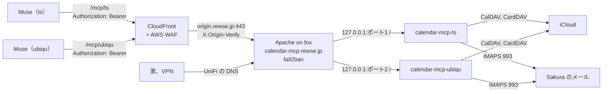

# Muse から iCloud のカレンダー、連絡先と Sakura のメールを使う MCP サーバー 設計

## 目的

Meta Muse から、iCloud のカレンダーと連絡先、Sakura のメール（rewse.jp）を一つの MCP サーバーで使えるようにする。使うのは利用者（ts）と妻（ubiqu）の二人で、それぞれの Muse から自分のアカウントだけを扱う。

メールは 2026-11-02 の設計（`2026-11-02-mailboxd-mcp-design.md`）で `mailboxd`（psyb0t/docker-mailbox）を `mail-mcp.rewse.jp` に公開して使えている。カレンダーにも MCP サーバーが要り、MarimerLLC/calendar-mcp はカレンダー、連絡先、IMAP のメールを一つのサーバーで扱える。メールもこちらに移せば、一人がつなぐコネクタは一つになり、fox で動かすサービスも一つになる。そこで mailboxd をやめて calendar-mcp に移す。

Muse の Secure Credentials Store が資格情報を差し込めるのは HTTPS のリクエストだけで、CalDAV や IMAP のログインには使えない。この事情は mailboxd のときと同じで、fox に HTTPS の MCP サーバーを置き、Muse にはベアラートークンだけを渡す。

## ゴール

- Mac の状態に関係なく、Muse から `https://calendar-mcp.rewse.jp/mcp/ts` と `https://calendar-mcp.rewse.jp/mcp/ubiqu` で次のことができる
  - カレンダー: 本人の Apple ID のすべてのカレンダー（ts は 6 個）の予定の一覧、読み取り、作成、更新、削除
  - 連絡先: iCloud の連絡先（CardDAV）の一覧、検索、読み取り、作成、更新、削除
  - メール: 一覧、検索、読み取り、フォルダー移動、ゴミ箱への移動、下書きの保存
- 一人に一つのトークンを発行し、各トークンでは本人の Apple ID と Sakura のメールボックスにしか触れない
- トークンを持っていても、メールの送信と配信停止はできない。メールの削除はゴミ箱への移動で、完全には消えない
- トークンの総当たりを fail2ban が止める
- 管理画面と管理 API にインターネットから届かない
- mailboxd を撤去し、`mail-mcp.rewse.jp` を片づける

## 範囲外

- メールの送信と配信停止。迷惑メールの本文に仕込まれた指示に Muse が従っても、外にメールを出させない。配信停止のリンクを踏むと、アドレスが生きていることを送り主に知らせてしまう。返信は下書きまでとし、送るのは本人がメールソフトから行う
- ゴミ箱からの完全削除
- カレンダーそのものの作成と削除
- kyn のメールを Muse から使うこと。mailboxd の撤去とともにやめる
- ICS の購読フィード、Google、Microsoft のアカウント
- calendar-mcp の LLM ルーター（Ollama、OpenAI などに問い合わせてアカウントを選ぶ機能）。外部に問い合わせさせない
- OAuth による認可
- 管理画面（`/admin/ui`）と管理 API（`/admin`）の利用。設定は Ansible が書く
- 上流のリポジトリの外で独自の変更を配布すること（fork から Release やイメージを出すこと）

## 制約

- Muse の接続元は Meta のクラウドで、アドレスがわからない。`Require ip` で絞れず、インターネット全体に公開することになる
- Muse のアプリには MCP サーバーの URL を登録する画面がない。チャットで頼んでカスタムコネクタを作らせ、トークンは Muse が開く入力欄から Secure Credentials Store に入れる。mailboxd で、この方法で使えることを確かめた
- 2 要素認証の Apple ID で CalDAV と CardDAV を使うには App 用パスワードが要る。App 用パスワードは範囲を絞れず、その Apple ID の iCloud のメール、連絡先、カレンダーすべてに届く
- 二人の Apple ID と Sakura のパスワードは利用者が管理しており、fox にまとめて置いてよい
- calendar-mcp の HTTP サーバーは、API キー一つで設定したすべてのアカウントに触れられる。アカウントごとの権限（`Permissions`）は操作の種類を絞るだけで、キーとアカウントは結びつかない
- calendar-mcp には GitHub の Release、タグ、配布イメージがない。上流は `Release 1.9.0 (#115)` のような題のコミットで版を上げ、`Directory.Build.props` の `VersionPrefix` を同じ版にしている。C#（.NET 10）で、ライセンスは MIT
- calendar-mcp の `unsubscribe_from_email` は、送信と同じ `emailSend` の権限で判定する。ツールを個別に無効にする設定はない
- calendar-mcp には下書きを保存するツールがない。`draft_reply` はプロンプトで、最後は送信に進む
- 上流の MCP エンドポイントは `/` にある。同じポートに `/admin`、`/admin/ui`、`/attachments`、`/health` もある
- CloudFront のオリジン読み取りタイムアウトは 60 秒
- このリポジトリは公開している。家族のメールアドレスと Apple ID はコミットしない。`ubiqu` は `roles/nas` ですでに公開している名前で、パスに使ってよい

## 方式

| 方式 | 内容 | 判断 |
|---|---|---|
| A | MarimerLLC/calendar-mcp を一人一つのコンテナで動かす。上流を `rewse/calendar-mcp` に fork し、足りない機能をテスト付きのコミットで足して、fox でその fork からビルドする | 採用 |
| B | ni-c/caldav-mcp を一人一つ動かし、stdio を HTTP に変える中継を挟む。メールは mailboxd のまま | 不採用。中継とベアラートークンの検証を自前で組むことになり、部品が増える。2026-09 に始まり 2 スターの若いプロジェクトである |
| C | CalDAV、CardDAV、IMAP の MCP サーバーを自作する | 不採用。必要な機能は A にそろっており、保守をすべて抱えることになる |
| A' | A でメールは mailboxd に残す | 不採用。コネクタが一人二つになり、似た公開の仕組みを二つ持つことになる |
| A'' | A で、fork の代わりに上流の Release にビルド時のパッチを当てる | 不採用。上流の更新に自動で追いつける利点はあるが、足す機能が下書き、下書きフォルダーの設定、ヘッダーの三つになり、そのテストもパッチに入る。上流の `Dockerfile` はテストを走らせず、このリポジトリの CI も .NET のテストを走らせないので、パッチのテストはどこでも実行されない。パッチを直すたびに clone、適用、差分の取り直しが要る |

A の弱点と対策は次のとおり。

- API キーがアカウントに結びつかない。一人一つのコンテナに分け、各コンテナには本人のアカウントだけを入れる
- 送信と配信停止を一つずつ止められない。`emailSend: false` で両方まとめて止める
- 下書きのツール、下書きフォルダーの設定、ヘッダーの取得がない。fork にテスト付きで足し、上流にも PR を出す
- 配布イメージがない。fox で fork からビルドする
- 上流の更新に自動では追いつかない。上流の新しい Release が待機期間を過ぎたら、fork の既定ブランチをその上に手で rebase する。PR がすべて取り込まれたら fork をやめ、上流の Release を `aged_release` で追う形に戻す

## 構成



### calendar_mcp ロール

新しいロール `calendar_mcp` を作り、fox の playbook（`home-primary.yml`）に加える。`roles/filebrowser` と `roles/mailboxd` を手本にし、コンポーネントは config、container、apache、fail2ban とする。イメージのビルドは、compose がそのイメージを使うので container コンポーネントに含める。

#### fork（`rewse/calendar-mcp`）

- `~/git/calendar-mcp` に clone する。既定ブランチは `rewse` とし、待機期間を過ぎた上流の `Release x.y.z` のコミットの上に、自分たちのコミットを積む。上流の `main` はそのまま上流を映す
- 足す変更は三つで、それぞれをコードとテストを含む一つのコミットにする。上流の作法（`src/CalendarMcp.Tests` の MSTest と Rocks のモック、`changelogs/`）に合わせる
  - 下書きフォルダーの設定: IMAP の `providerConfig` に任意の `draftsFolder` を足し、`drafts` の別名（`move_email` と `get_emails` の `folder`）がそれを使う。Sakura は SPECIAL-USE を広告せず、下書きフォルダーは `INBOX.Draft` なので、これがないと下書きの置き場所が見つからない
  - 下書きの保存: ツール `save_draft` を足す。引数は `accountId`、宛先、件名、本文、本文の形式、CC、返信元のメール ID（任意）とする。返信元があれば `In-Reply-To` と `References` を付ける。権限は `emailRead` で判定する。メールボックスの中を整理する操作と同じ扱いで、外には何も出さないからである。`IProviderService` には既定の実装（`NotSupportedException` を投げる）付きでメソッドを足し、IMAP 以外のプロバイダーには手を入れない
  - ヘッダー: ツール `get_email_headers` を足す（下の「ヘッダーの取得」）。上流はヘッダーを返さず、Muse が迷惑メールの判定に使う `ARC-Authentication-Results` を読めない
- 三つの変更はそれぞれ上流の `main` を元にしたブランチにも置き、上流に PR を出す（PR を出すのは後日でよい）
- 上流の `ci.yml` は `main` でしか走らないので、`rewse` でも `dotnet test` が走るよう、fork だけのコミットで CI の対象ブランチを足す。上流の `release.yml` と `claude.yml` は fork では無効にする
- fork は AGENTS.md の「GitHub Configuration」の対象外（upstream の fork）とする

#### ヘッダーの取得

- `get_email_headers` の引数は `accountId` と `emailId` とし、応答は `headers`（`name` と `value` の組の並び）だけにする。並びはメッセージの中の順で、`Received` のように繰り返す欄は別々の要素にする。権限は `emailRead` で判定する
- ツールは上流の `get_unsubscribe_info` と同じく `GetEmailDetailsAsync` を呼び、結果の `EmailMessage.Headers` を返す。`IProviderService` は変えない
- `EmailMessage.Headers` は、IMAP、M365、Outlook.com、Google の四つのプロバイダーで、詳細を取るときに埋める。四つとも詳細を取るときにヘッダーをもう受け取っている（IMAP は MIME メッセージ、M365 と Outlook.com は `internetMessageHeaders`、Google は `Payload.Headers`）。一覧と検索では埋めない。M365 と Outlook.com は手元にアカウントがないので、変換の単体テストまでで確かめる。Google は単体テストに加えて、上流に PR を出すときに利用者の Gmail のアカウントで実際に確かめる（「確かめること」の「上流に PR を出すとき」）。fox で使うのは IMAP だけなので、fox への反映はこの確認を待たない
- `Headers` が null のプロバイダーでは、ツールはヘッダーを返せないというエラーにする
- `get_email_details` の応答と説明文は変えない
- 上流の作法に合わせて `changelogs/` に記録を足す。`docs/mcp-tools.md` と `src/CalendarMcp.Core/Skills/email.md` は、上流に PR を出すときに `save_draft` とあわせて書く

| 方式 | 内容 | 判断 |
|---|---|---|
| H1 | 新しいツール `get_email_headers` | 採用。既存のツールの応答も引数も変わらない。上流にも、ヘッダーから読んだ情報を返す専用のツール `get_unsubscribe_info` がある。上流の PR で見る範囲が一番狭い |
| H2 | `get_email_details` に引数 `includeHeaders`（既定 false）を足す | 不採用。ツールの数は増えないが、既存のツールの引数と説明文に条件が入る |
| H3 | `get_email_details` が常にヘッダーを返す | 不採用。ヘッダーは DKIM の署名や `Received` の連なりで 1 通あたり数 KB になり、詳細を読むたびに応答が膨らむ。上流の PR で最も受け入れられにくい |

#### イメージのビルド

- `aged_release` の `github-commit:` で `rewse/calendar-mcp` の既定ブランチの最新のコミットを選ぶ。自分のリポジトリなので待機期間は付けない（`days=0`）。上流から取り込むコミットの待機期間は、rebase の元を待機期間を過ぎた Release に限ることで守る
- `/usr/local/src/calendar-mcp` に、選んだコミット SHA で checkout する
- ビルドは fork の `Dockerfile` を使い、イメージのタグはコミット SHA の先頭 12 文字にする（例: `calendar-mcp:6486836...`）。checkout の前にイメージの有無を確かめるので、checkout してから分かる版はタグに入れない。ビルドは fox で行い、同じタグのイメージがあればビルドを飛ばす
- `aged_release` の `github-commit:` に足した題の正規表現の引数（`message`）は、PR がすべて取り込まれて上流の Release を追う形に戻すときに使う

#### config コンポーネント

- 一人に一つ、`appsettings.json` を描画する。アカウントは二つ
  - IMAP: Sakura（`imapHost` は `rewse.sakura.ne.jp`、993、TLS）。`smtpHost` は名前解決できない `smtp.invalid`（RFC 2606）とする。上流は IMAP と SMTP に同じ `password` を使うが、`emailSend: false` で SMTP への接続まで進まず、進んでも名前解決で止まる
  - DAV: `preset: icloud`。`enableCalendar` と `enableContacts` を true にする
- `Permissions` は両方のアカウントに明示する。省くとすべて許す動作になるからである
  - IMAP: `emailRead: true`、`emailSend: false`、それ以外は false
  - DAV: `calendarRead`、`calendarWrite`、`contactsRead`、`contactsWrite` を true、`emailRead` と `emailSend` を false
- Router は設定しない、または外部に問い合わせないよう無効にする
- `ExternalBaseUrl` は `https://calendar-mcp.rewse.jp/mcp/<名前>` にする。https の値でないと API キーの強制と両立しない
- `RequireApiKey` は true（既定値）のままにする
- メールアドレス、Apple ID、パスワード、App 用パスワードは 1Password から実行時に読む。`appsettings.json` はコンテナの利用者だけが読める権限にし、読み取り専用でマウントする。上流がこのファイルを書き換えるのは管理画面と管理 API からの操作だけで、どちらも閉じるので、Ansible の描画と食い違わない（設計者の判断）
- 管理画面のサインイン（OIDC）は設定しない

#### container コンポーネント

- Compose プロジェクトは `/etc/compose/calendar_mcp/compose.yaml` 一つで、サービスを一人一つ置く（`calendar-mcp-ts`、`calendar-mcp-ubiqu`）
- 待ち受けは `127.0.0.1` のみ。ポートは一人一つ、fox で空いているものを選ぶ
- 状態（`/app/data` の `mcp-keys.json`、ログ、DataProtection の鍵）は `/srv/calendar_mcp/<名前>` をバインドマウントして残す
- 環境変数
  - `CALENDAR_MCP_MCP_KEY`: 本人のトークン。こうするとキーはデータディレクトリに書かれない
  - `CALENDAR_MCP_ADMIN_TOKEN`: 長いランダムな値。管理画面は Apache で閉じるが、空や既定値（`changeme`）のままにはしない
  - これらは `.env`（root だけが読める権限）に描画し、`env_file` で渡す
- mailboxd と同じ守り（`read_only`、`cap_drop: [ALL]`、`no-new-privileges`、tmpfs の `/tmp`、メモリと PID の上限、ヘルスチェック）を付ける。.NET が書き込みを求める場所は実装者が確かめて tmpfs かバインドマウントにする
- 再作成の handler には `wait: true` と `wait_timeout` を付ける

#### apache コンポーネント

- `templates/calendar-mcp.rewse.jp.conf.j2` を置く
- `/mcp/ts` を ts のコンテナの `/` に、`/mcp/ubiqu` を ubiqu のコンテナの `/` に `ProxyPass ... flushpackets=on` で流す。`ProxyPreserveHost on` とする
- 外から届くのは `/mcp/ts`、`/mcp/ubiqu` の完全一致のパスと、家と VPN からのヘルスチェックだけにする。それ以外（`/mcp/ts/admin`、`/mcp/ts/attachments`、`/mcp/ts/sse` などの下の階層を含む）は `Require all denied` にする。mailboxd の `<LocationMatch "^/(?!(mcp(/.*)?|health)$)">` と同じ考え方で、正規表現は下の階層を含めないよう書き直す
- `Require ip` は付けない
- 証明書は既存の `*.rewse.jp` を使う

#### fail2ban コンポーネント

- フィルタは `calendar-mcp.rewse.jp` の vhost で `/mcp/ts` と `/mcp/ubiqu` に 401 が返った行に一致させる。`/.well-known/` は MCP クライアントがトークンを送る前に読むことがあるので対象外とする
- ジェイルの形は mailboxd に合わせ、`tests/test_fail2ban_apache.py` の一覧に加える
- 誤ったトークンで BAN されると、接続元を共有している家族も一時間使えなくなるが、許容する

#### 1Password

- Sakura の項目は mailboxd と同じもの（ts: `scuhuvks3pdlwlgkvnzlaptyke`、ubiqu: `2eb4e5qbwgl555366yquo3wufy`）を使う
- MCP のトークンは mailboxd の項目（ts: `7tbut3qmtfp7dettl6hqsh6tei`、ubiqu: `pjplhxwrdrm25hob63i37iqdkm`）を引き継がず、新しく `calendar-mcp - ts`、`calendar-mcp - ubiqu` を作る。古いトークンは mailboxd とともに失効させる
- Apple ID と App 用パスワードの項目を一人一つ `ansible` vault に作る。App 用パスワードは利用者が appleid.apple.com で発行する（ラベルは `calendar-mcp` など）
- 管理トークンも一人一つ作る
- コミットするのは項目 ID の Secret Reference だけにする
- 項目は `ansible` vault に作る。サービスアカウントは読み取りだけなので、`env -u OP_SERVICE_ACCOUNT_TOKEN op item create` で作る。トークンは `openssl rand -hex 32` で作る

#### テスト

`tests/test_calendar_mcp.py` で、テンプレートを描画して次を確かめる。

- 待ち受けがループバックだけである
- 各 `appsettings.json` にアカウントが二つだけあり、どちらにも `Permissions` があり、`emailSend` が false である
- IMAP の `smtpHost` が `smtp.invalid` である
- Router が外部に問い合わせない
- `.env` の権限
- vhost のプロキシ先、許すパスと拒むパス
- ジェイルの設定、フィルタが一致する行と一致しない行

### 他のリポジトリと DNS

AGENTS.md の「Subdomains」の手順に従う。

- `~/git/cloudfront-waf`: `calendar-mcp.rewse.jp` を別名と `SUBDOMAINS` に加え、テストと文書を直してデプロイする。mailboxd の撤去のときに `mail-mcp.rewse.jp` を外す
- UniFi: `calendar-mcp.rewse.jp` を `fox.rewse.jp` に向ける CNAME の DNS ポリシーを加える。撤去のときに `mail-mcp.rewse.jp` のポリシーを消す
- `~/git/security-agent`: `calendar-mcp.rewse.jp` を毎月のペネトレーションテストに加え、対象ドメインを検証する。撤去のときに `mail-mcp.rewse.jp` を外す。テストの日は既存の 13 日（zabbix）と重ならない日にする。mailboxd の 26 日を引き継いでもよい
- `~/git/chezmoi`: クライアント設定に URL を書く場所はないので変更しない

### 更新

上流の新しい Release が待機期間（`supply_chain_cooldown_days`）を過ぎたら、fork の `rewse` をその上に rebase し、`dotnet test` を通して push する。`update` タグでは fork の新しいコミットを選び、ビルドし直す。上流は 1.x で、変更ごとに changelog（`changelogs/`）を残しているので、rebase の前に読む。PR が上流に取り込まれたら、そのコミットは rebase で消える。三つとも取り込まれたら、`aged_release` の対象を上流の Release（`message='^Release (\d+\.\d+\.\d+)'`）に戻し、fork を archive する。

## 進め方

1. `aged_release` に題の正規表現の引数を足し、fork を作って三つの変更をテスト付きで積む
2. fox に `calendar_mcp` ロールを入れる。まず ts のコンテナだけを使い、家から確かめる。この段階では mailboxd はそのまま動かしておく
3. Cloudflare の Quick Tunnel を fox で手で起動し、ts のコンテナに直接つないで、Muse から確かめる。確かめ終わったらトンネルを止める。mailboxd で使った手順と同じ
4. 段階 3 が通ったら、cloudfront-waf、UniFi の DNS、security-agent を入れ、Muse のコネクタの URL を `https://calendar-mcp.rewse.jp/mcp/ts` に替える
5. ubiqu の Muse にコネクタを作る
6. 二人とも新しいコネクタで使えるのを確かめてから、mailboxd を撤去する。ロール、`/etc/compose/mailboxd`、`/srv/mailboxd`、vhost、fail2ban のジェイル、cloudfront-waf の別名、UniFi の DNS ポリシー、security-agent の対象、Muse の古いコネクタを片づける。kyn を含む mailboxd のトークン項目を 1Password から消す前に、利用者に確かめる

## 確かめること

- 段階 2
  - 家から `/mcp/ts` にトークンなしで POST すると 401 が返る
  - `/mcp/ts/admin`、`/mcp/ts/admin/ui`、`/mcp/ts/attachments` は 403 が返る
  - ts のトークンで `list_accounts` を呼ぶと、ts の二つのアカウントだけが見える
  - ts のトークンで `/mcp/ubiqu` を呼ぶと 401 が返る
  - `send_email` と `unsubscribe_from_email` は呼ぶと拒否される
- 段階 3: Muse から次のことができる
  - カレンダーの一覧（6 個）
  - 予定の作成、更新、削除
  - 連絡先の検索
  - メールの一覧、検索、読み取り、ヘッダーの取得、移動、ゴミ箱への移動、下書きの保存
  - 送信と配信停止は拒否される。下書きが Sakura の Drafts フォルダーにあり、送信済みフォルダーには何も増えていない
- 段階 4: CloudFront 経由で段階 3 と同じことができる。WAF のログで、Muse の通信が誤検知されていないことを見る
- 段階 5: ubiqu の Muse でも段階 3 と同じことができ、ts のアカウントは見えない
- 段階 6: `mail-mcp.rewse.jp` に届かず、fox に mailboxd のコンテナとファイルが残っていない
- 上流に PR を出すとき: Mac で動かした fork に、利用者の Gmail のアカウントを権限 `emailRead` だけで一時的に足す。`get_email_headers` が、`Received` と認証の結果（`Authentication-Results` か `ARC-Authentication-Results`）を含むヘッダーを返す。利用者は Google Cloud のプロジェクトも OAuth クライアントも持っていないので、このときに作る。上流の CLI は送信を含む既定のスコープで認可を求めるので、確かめたらアカウントを外し、Google のアカウントの設定でこのアプリのアクセスを取り消し、プロジェクトを消す。fox には Gmail のアカウントを入れない

## 残るリスク

- App 用パスワードは iCloud のメール、連絡先、カレンダーすべてに届く。fox が侵害されると、二人の iCloud と Sakura のメールが読まれる。App 用パスワードは appleid.apple.com で一つずつ取り消せる
- 監査ログが mailboxd より弱いかもしれない。mailboxd はツールの呼び出しごとに SQLite に記録していたが、calendar-mcp がツールの呼び出しをどこまでログに残すかは確かめていない。fox で試した範囲では、ツールの呼び出しは accountId 付きで INF のログに残る
- 予定と連絡先の削除は取り消せない。利用者が選んだ
- 上流の開発が止まる、または互換性のない変更が続く場合。fork のコミット SHA で固定しているので急に壊れはしない。rebase の手直しが重くなれば、乗り換えをその時点で判断する。PR が断られた変更は fork に残り続ける
- 一人一つのコンテナに .NET のランタイムが載るので、mailboxd よりメモリを使う

## 実装者に任せること

- 待ち受けのポート番号
- 1Password の項目の作り方と項目 ID
- 一人ずつの設定を並べる変数の形
- `aged_release` の新しい引数の名前
- fork の変更の細部（ツールの説明文、引数名、HTML 本文への対応）
- ビルドの方法（`community.docker.docker_image_build` か Compose の `build:` か）とイメージのタグの形
- `/srv/calendar_mcp` をバックアップの対象に加えるかどうか
- ログの水準とメモリの上限
- ペネトレーションテストの日

## 付録: 段階 3 で Muse に渡すプロンプト

事前に、件名に「calendar-mcp テスト」を含むメールを自分のアドレスに送っておく。`<トンネルの名前>` は cloudflared が表示した名前に置き換える。トンネルはコンテナに直接つなぐので、パスは `/` になる。段階 4 では URL だけを替えるよう Muse に頼む。

```text
iCloud のカレンダー、連絡先と Sakura のメール用のカスタムコネクタを作ってほしい。

- 接続先はリモートの MCP サーバー。トランスポートは Streamable HTTP で、URL は https://<トンネルの名前>.trycloudflare.com/
- すべてのリクエストに Authorization: Bearer <トークン> ヘッダーを付ける。トークンは CALENDAR_MCP_TOKEN という名前で Secure Credentials Store に保存したいので、安全な入力欄を開いて。チャットには貼らない
- 公式の MCP SDK でクライアントを書き、initialize のあと tools/list で使える道具の一覧を見せて
- list_accounts でアカウントの一覧を見せて。メール用とカレンダー、連絡先用の二つがあるはず。送信と配信停止はできない設定になっている

道具の一覧が見えたら、次の順に試して、それぞれの結果を見せて。
1. カレンダーの一覧
2. 今週の予定
3. 明日の正午から 30 分の予定「calendar-mcp テスト」を作成し、タイトルを「calendar-mcp テスト（更新）」に変え、最後に削除する
4. 連絡先で自分の名前を検索する
5. INBOX の新しいメール 5 件の差出人、件名、日時
6. 件名に「calendar-mcp テスト」を含むメールを検索し、本文を読む
7. そのメールのヘッダーを get_email_headers で取り、ARC-Authentication-Results（SPF、DKIM、DMARC の結果）と Received を見る
8. そのメールを迷惑メールのフォルダーに移動し、次に INBOX に戻す
9. そのメールへの返信を save_draft で下書きとして保存する（送信はしない）
10. そのメールをゴミ箱に移動する
11. send_email と unsubscribe_from_email が拒否されることを確かめる。send_email を試すときの宛先は自分のアドレスにする

最後に、このコネクタの使い方をスキルとして保存して。URL はあとで差し替えるので、1 か所で変えられるようにしておいて。
```
